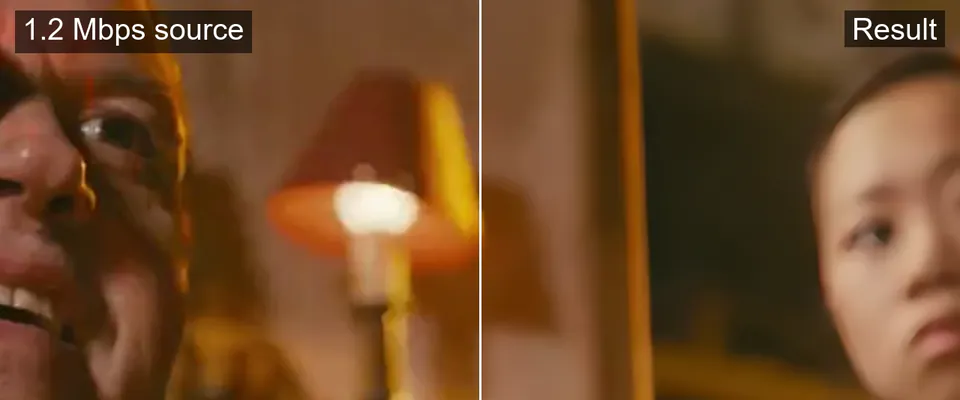
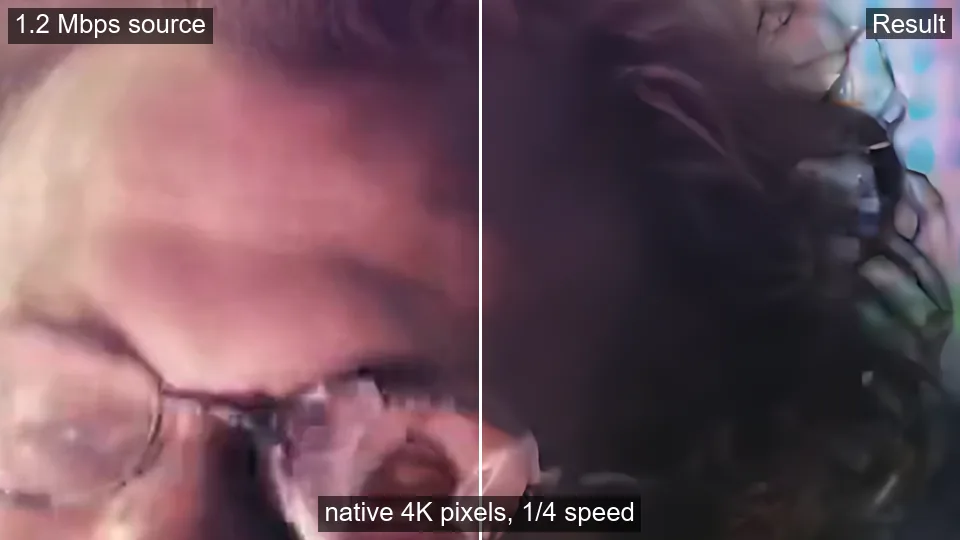
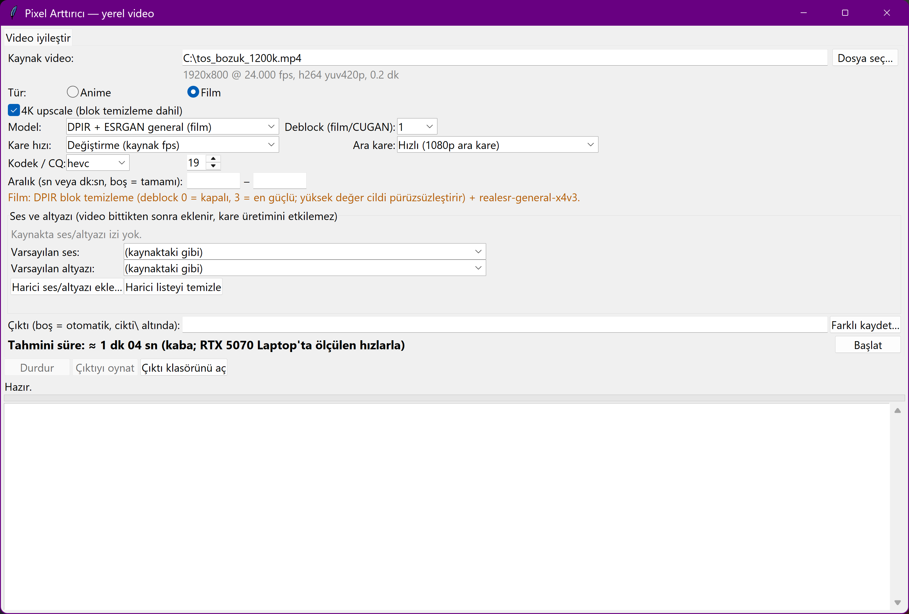
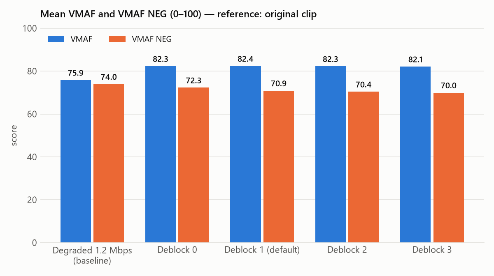
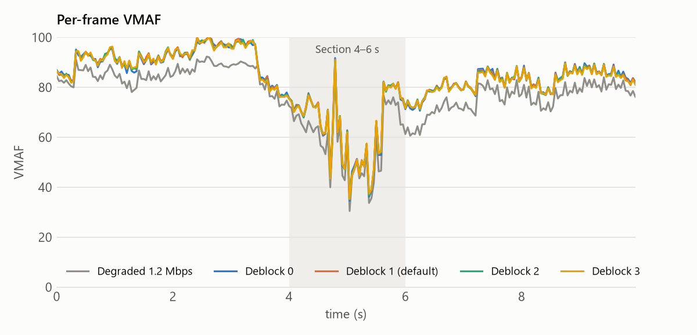
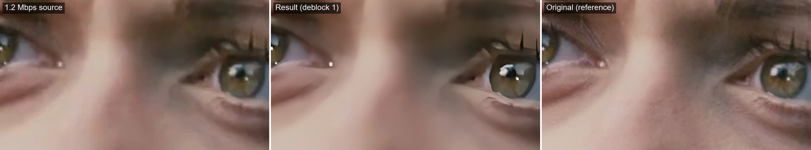
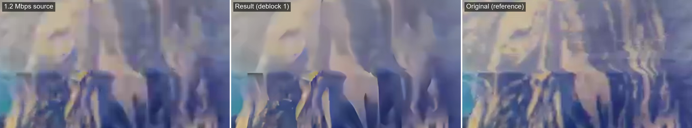
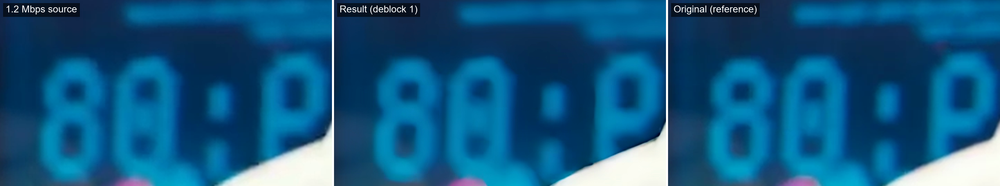

# Pixel Arttırıcı

**Offline 4K upscaler for low-bitrate 1080p video on Windows + NVIDIA RTX.**
It removes compression blocking and sharpens the picture (DPIR + Real-ESRGAN via TensorRT, or Real-ESRGAN anime via Video2X),
keeps the tone stable, can optionally raise the frame rate with RIFE, and carries all audio/subtitle tracks over untouched.

[Türkçe README](README.tr.md)



*Tears of Steel, deliberately degraded to 1.2 Mbps and processed with the default film settings. Left of the line: source (scaled to 4K with lanczos), right: result.
A 640x267 region of the 4K output, enlarged 1.5×, so the difference is visible at README size; at full-frame size it is subtler.*



*Same clip, a moving face at ¼ speed, native 4K pixels (960x540 region): the source's blocks crawl as the head turns; the result keeps cleaner edges on the glasses and face.*

> **What to expect, honestly.** On average the result looks clearly cleaner and sharper (VMAF +6.5).
> It does **not** bring the picture closer to the original: VMAF NEG and PSNR, which do not reward sharpening, stay flat or drop slightly.
> In the most heavily blocked fast-motion frames lost detail does not come back and the gain is small.
> These figures come from a single 10-second film clip (see [Measurements](#measurements)).

---

## Who is it for?
You have a 1080p (or SD) file that was encoded at a low bitrate (streaming rips, old downloads, TV recordings) and blocks or smears
in busy scenes, and you want a cleaner 4K file to watch on a TV, not a real-time filter. Processing is slow (hours per episode), the result is a new file.

## Requirements
| | |
|---|---|
| OS | Windows 10/11, 64-bit |
| GPU | NVIDIA **RTX** (20-series or newer, compute capability ≥ 7.5), driver **≥ 580** |
| Python | **3.14** from python.org (with the `py` launcher and tkinter, both included by default) |
| Disk | ~10 GB free during installation, ~4.5 GB afterwards (plus room for 4K output files) |
| Internet | only for installation (about 3.6 GB of downloads) |

Developed and measured on an RTX 5070 Laptop GPU.

## Installation
1. Download this repository (green **Code** button → *Download ZIP*) and extract it, or `git clone` it.
2. Double-click **`kurulum.bat`**, or in PowerShell inside the folder:
   ```powershell
   .\kurulum.bat                 # tools and models
   .\kurulum.bat -VideoCompare   # optionally also the side-by-side viewer (see "Inspect it yourself")
   ```

The installer checks GPU, driver, Python and disk space, then downloads everything from the official sources into `tools\` and `models\`
inside this folder (nothing is installed system-wide). Every file has a pinned version, size and SHA-256; a mismatch stops the installation.
Already-installed parts are skipped, interrupted downloads resume. The film model is converted from the official Real-ESRGAN `.pth`
release to ONNX locally (no PyTorch needed). The first run of each new video size builds TensorRT engines once (~1–4 min).

> All commands in this README are for **PowerShell**. In cmd.exe drop the leading `.\` and `&`.

## Usage
### Graphical interface
Double-click **`arayuz.bat`** (or `.\arayuz.bat`). Pick a video, choose *Film* or *Anime*, press **Başlat** (Start).
The estimated time, progress and remaining time are shown; the exact command that runs is written to the log and can be pasted as-is into PowerShell opened in the repository folder.
The interface is in Turkish:



| label | meaning |
|---|---|
| Kaynak video / Dosya seç… | source video / choose file |
| Tür: Anime / Film | content type (picks the model) |
| 4K upscale (blok temizleme dahil) | 4K upscale incl. deblocking |
| Deblock | deblocking strength 0–3 (film, CUGAN) |
| Kare hızı / Ara kare: Hızlı, Kaliteli | frame rate / interpolation method: fast, quality |
| Aralık | process only a time range (for a quick test) |
| Ses ve altyazı / Harici ses/altyazı ekle… | audio & subtitle tracks / add external file |
| Çıktı / Başlat / Durdur / Çıktıyı oynat | output / start / stop / play output |

### Command line
```powershell
# Film, default settings → cikti\<name>_film_general4x_dpir15_hevc.mkv
py -3.14 yerel\iyilestir.py "C:\Videos\movie.mkv" --tur film

# Anime, try 10 seconds first (5:00–5:10)
py -3.14 yerel\iyilestir.py "C:\Videos\episode.mkv" --tur anime --baslangic 300 --bitis 310

# 4K + 72 fps, Japanese audio (track 2) and an external Turkish subtitle as default
py -3.14 yerel\iyilestir.py "C:\Videos\episode.mkv" --tur anime --hedef-fps 72 --ses 2 --varsayilan-ses 2 `
    --ek "C:\Videos\episode.tr.srt" --varsayilan-altyazi -1
```
Track indices for `--ses` / `--altyazi`: the interface lists them, or
`.\tools\ffmpeg\bin\ffprobe.exe -v error -show_entries stream=index,codec_type:stream_tags=language,title -of compact "C:\Videos\episode.mkv"`.

### All options (`yerel\iyilestir.py`)
| option | meaning |
|---|---|
| `--tur film\|anime` | **required.** Picks the default model. |
| `--model esrgan\|general\|cugan\|anime4k` | `general` (film default): DPIR deblocking + realesr-general-x4v3, TensorRT. `esrgan` (anime default): Real-ESRGAN animevideov3 via Video2X. `cugan`: Real-CUGAN, stronger deblocking but may shift tone. `anime4k`: fast, weak. |
| `--deblock-guc 0-3` | `general`: DPIR strength 0 / 15 / 30 / 50, **default 1**. Higher values smooth skin and texture. `cugan`: noise level (default 3). |
| `--olcek auto\|2\|3\|4` | upscale factor; `auto` picks the smallest that reaches ~2160 px height |
| `--baslangic`, `--bitis` | process only this range (seconds); the clip is cut losslessly first |
| `--codec hevc\|av1`, `--cq 19` | NVENC 10-bit; lower CQ = higher quality, larger file |
| `--hedef-fps 72\|120\|144` | raise the frame rate with RIFE to the nearest integer multiple of the source |
| `--fps-yontem hizli\|kalite` | `hizli` (default): real frames untouched, only in-between frames computed at 1080p with RIFE 4.26 TensorRT. `kalite`: Video2X RIFE at full 4K, ~10× slower. |
| `--rife-model` | RIFE model for `kalite` (default `rife-v4.26`) |
| `--kesme-serbest` | turn off scene-cut handling (cuts will be blended) |
| `--sira upscale-once\|fps-once` | order of upscale and RIFE; `upscale-once` (default) is better and ~2× faster |
| `--sadece-kalite`, `--sadece-fps` | only upscale / only frame-rate conversion |
| `--ton-serbest` | turn off tone stabilisation |
| `--ham-sakla` | keep the raw model output before tone stabilisation |
| `--taramali iki-kat\|ayni\|kapali` | interlaced SD sources: `iki-kat` (default) one frame per field (25i → 50p), `ayni` keep frame rate, `kapali` don't touch |
| `--ses`, `--altyazi` | `hepsi` (all, default), `yok` (none) or comma-separated stream indices |
| `--varsayilan-ses`, `--varsayilan-altyazi` | default track (source index; `-1`, `-2` … = first, second external file) |
| `--ek FILE` | external audio/subtitle file, repeatable; `.tr`/`.en`/`.jp` in the name sets the language |
| `-o FILE` | output file |

A half-finished job restarted with the same settings skips completed stages (e.g. a 4-hour upscale). Every run appends a line to `cikti\iyilestir_log.csv`.

**SD / DVD files** (`.vob`, `.mpg`, `.mpeg`, `.m2v`, or any SD source) go through a lossless preparation step first: interlacing is detected (`idet`) and
removed (`bwdif`), NTSC 3:2 pulldown is reversed, non-square pixels are made square, BT.601 colour is converted to BT.709 and output larger than 4K is fitted into 3840x2160.
Multi-part DVD titles (`VTS_01_1.VOB`, `VTS_01_2.VOB` …) must be joined into one file beforehand.

## Measurements
Source: *Tears of Steel* 06:51–07:01 (10 s, 1920x800, 24 fps), **deliberately re-encoded to 1.2 Mbps** (x264 medium, single-pass ABR).
Reference: the original clip. Processed 4K output is downscaled back to the reference size with lanczos and compared with libvmaf
(VMAF and **VMAF NEG**, a variant that does not reward sharpening or contrast gain), PSNR-Y and SSIM.
Frames are aligned by index (timestamps re-generated), all 240 frames measured. Tool: `yerel\olc.py`; every step to reproduce: [docs/uret.md](docs/uret.md).

| video | VMAF | VMAF NEG | VMAF min | PSNR-Y (dB) | SSIM |
|---|--:|--:|--:|--:|--:|
| Degraded 1.2 Mbps (baseline) | **75.87** | **73.95** | 30.44 | 37.96 | 0.9732 |
| Deblock 0 | **82.33** | **72.32** | 34.51 | 35.92 | 0.9716 |
| Deblock 1 (default) | **82.39** | **70.91** | 35.25 | 35.20 | 0.9700 |
| Deblock 2 | **82.26** | **70.41** | 35.26 | 34.95 | 0.9693 |
| Deblock 3 | **82.13** | **69.96** | 35.19 | 34.74 | 0.9686 |

Fast-motion section only (4–6 s, 48 frames):

| video | VMAF | VMAF NEG | PSNR-Y (dB) | SSIM |
|---|--:|--:|--:|--:|
| Degraded 1.2 Mbps (baseline) | **58.80** | **57.22** | 33.74 | 0.9366 |
| Deblock 1 (default) | **64.32** | **56.40** | 31.65 | 0.9320 |




How to read it:
- **VMAF rises by 6.5 points** over the whole clip and by 5.5 in the fast-motion section; visually the blocks are gone and edges are sharper.
- **VMAF NEG and PSNR do not rise.** The gain is perceived sharpness, not a reconstruction of the original: the model invents plausible detail and smooths fine texture (skin pores, grain), see the crops below.
- **Heavily blocked fast-motion frames** (around 5 s) stay almost as bad as the source; lost information does not come back.
- **Deblock strength** barely changes VMAF on this clip, but higher strengths lower NEG/PSNR (more smoothing). The default is 1.
- **Frame-rate conversion does not hurt the real frames:** with `--hedef-fps 72` (fast method) the measured real frames score 82.05 VMAF / 70.31 NEG versus 82.26 / 70.41 at 24 fps (deblock 2; the small difference comes from one extra encode).
- Limits of this sample: one 10-second film clip; anime was judged by eye only. Output bitrate (~17 Mb/s for 4K 10-bit) is not a quality measure.

### Detail crops (2× zoom): source | result | original
Face (t = 1 s): eyes, lashes and edges are sharper and the blocks on the skin are gone, but the fine skin texture of the original is smoothed away.

Fast motion (t = 5.2 s), the worst-blocked part of the clip: blocks are softened, the detail of the original does not come back.

Screen text (t = 8 s): slightly cleaner edges; small difference.


## Speed
Measured on an RTX 5070 Laptop GPU (driver 596.21) with an Intel Core i7-14650HX, on AC power, with TensorRT engines already built and all other GPU work stopped (checked with `nvidia-smi`).
The speed is the same whether the interface is in front, minimized or behind another application (10-second film clip: 75.4 s / 76.5 s / 75.8 s), see *No background throttling* below.

| job | source | model stage | whole job¹ | 24-min episode (estimate) |
|---|---|--:|--:|--:|
| Film, default (DPIR + realesr-general-x4v3) | 1920x800 | 3.9 fps | 3.2 fps | ~3.0 h |
| Anime, default (Real-ESRGAN animevideov3, Video2X) | 1920x1080 | 4.0 fps | 2.5 fps | ~3.8 h |
| + `--hedef-fps 72` (fast RIFE, on the 4K film output) | 3840x1600 | 52 output fps | +14 s per 10 s of video | +~0.6 h |

¹ Including tone stabilisation (CPU) and 10-bit HEVC encoding. A 1920x1080 film source has ~35 % more pixels than the 1920x800 clip and will be slower accordingly (not measured).
`--fps-yontem kalite` (Video2X RIFE at 4K) takes roughly 10× as long as the fast method. Speeds are frames of the *source* per second.

## Inspect it yourself
Install the optional viewer once: `.\kurulum.bat -VideoCompare` ([video-compare](https://github.com/pixop/video-compare), GPL-2.0, into `tools\video-compare`). Then:
```powershell
.\tools\video-compare\video-compare.exe -W "C:\Videos\movie.mkv" ".\cikti\movie_film_general4x_dpir15_hevc.mkv"
```
Both videos play frame-synchronised; drag the vertical line with the mouse (left = source, right = result). The 1080p source is scaled to the 4K output automatically.
Keys: `Space` play/pause · `A`/`D` previous/next frame · `Z` magnifier · `0` difference view · `Tab` next right-hand video · `H` help · `Esc` quit.
Several results against one source: `.\tools\video-compare\video-compare.exe -W source.mkv result1.mkv result2.mkv` (switch with `Tab`).
If the two files start at slightly different times, shift the right one with `-t 0.042` (seconds).

To render comparison videos and stills instead: `py -3.14 yerel\karsilastir.py <source> <result> --mod kayar|bolunmus|ust-alt|yanyana [--kirp X:Y:W:H]`,
and objective numbers: `py -3.14 yerel\olc.py <original> <result...> --taban <source>` (see [docs/uret.md](docs/uret.md)).

## Design decisions
- **Tone stabilisation.** Upscaling models shift brightness and colour differently per scene (Real-CUGAN darkened dark frames by up to 4.5 luma levels), which feels like HDR switching on and off.
  After upscaling, the coarse tone of every frame is matched back to the source: `output = processed + blur(source) − blur(processed)`, computed on a 32x18 grid and averaged over 9 frames.
  A finer grid without temporal averaging made the correction flicker around subtitles and moving characters. Off with `--ton-serbest`.
- **Own scene-cut detection** (`ortak\sahne.py`). Video2X's single threshold failed both ways on test clips: it missed a dark cut (two scenes blended) or treated anime's held frames and slow pans as cuts and stopped interpolating.
  ffmpeg's `scdet` had the same problem. The rule used: colour-histogram difference ≥ 0.35, or a motion-compensated difference well above the median of its moving neighbours (held/repeated frames ignored).
  At a cut the previous frame is held instead of generating blended frames.
- **Fast interpolation.** Real frames pass through untouched; only the in-between frames are computed at 1080p with RIFE 4.26 (TensorRT) and scaled up. About 10× faster than Video2X RIFE at full 4K; the measured real frames are essentially unchanged (−0.2 VMAF from one extra encode).
- **BT.709 tag bug.** ffmpeg 8 tagged the colour matrix as BT.601 on a packing-only `yuv420p10le → p010le` conversion while the values were BT.709, so players decoded with the wrong matrix and pink/red scenes turned darker (green channel −7).
  Every encode now writes explicit BT.709 tags, and the filter chains end with `setparams`, because output flags (`-color_trc`, `-color_primaries`) did not override frame properties and left them `unknown` when the source had none.
- **Audio and subtitles.** The video is produced on its own; the selected source tracks and external files are muxed in at the end without re-encoding, so audio never affects frame generation.
  ASS fonts are carried over (attachments mapped last because of an ffmpeg 8 stream-index bug). For partial processing the audio is re-encoded to FLAC, because copied audio starts at the previous keyframe and drifts.
  `-max_interleave_delta 0` is set because ffmpeg otherwise wrote all audio at the start of a long 4K file and players lost sound after seeking.
- **No background throttling.** Windows 11 lowers the quality of service of an application whose window is minimized while another app is in front, together with its child processes (efficiency cores, lower clocks).
  Before the fix the CPU-bound tone stage of the 10-second clip took 84 s instead of 14 s (whole job 147 s instead of 76 s) in that situation; the GPU stages were not affected.
  The job and every tool it starts (ffmpeg, vspipe, Video2X) are now explicitly opted out of power throttling (`SetProcessInformation` / `ProcessPowerThrottling`, no administrator rights; the process priority is not changed).
- **Correct GPU in Video2X.** Video2X's Vulkan device order follows Windows' current GPU preference; on one run `-d 0` silently picked the integrated GPU (~20× slower). The discrete NVIDIA GPU is looked up by name on every run.
- **Measurement alignment.** Comparing without regenerating timestamps gave the degraded clip a VMAF of 59.2 instead of 75.9 (B-frame timestamps shifted the frame pairing); `olc.py` aligns by frame index, searches ±3 frames of offset and measures only real frames of interpolated output.

## Known limitations
- Windows and NVIDIA RTX only (TensorRT, NVENC 10-bit).
- See [Measurements](#measurements): sharper and cleaner, but not closer to the original; heavily blocked fast-motion frames are not rescued; fine texture is smoothed. On noisy SD home recordings the result can look plastic.
- Only one 10-second film clip was measured objectively.
- `--fps-yontem kalite` (Video2X RIFE) loses the last 2 frames of the video (e.g. 142 of 144 in a 2-second test); the rest of the file and audio sync are not affected. The default fast method is not affected.
- The first run for each new video size or model builds TensorRT engines (~1–4 min).
- High-frame-rate 4K output (72/120 fps) is often not played by TVs with 60 Hz panels.
- Multi-part DVD titles have to be joined beforehand; only single files are accepted.
- The interface and messages are in Turkish.

## Credits and licences
Code in this repository: [MIT](LICENSE). Third-party tools and models are **not** part of the repository; `kurulum.ps1` downloads them from their official sources and they keep their own licences:

| component | licence | source |
|---|---|---|
| Video2X 6.4.0 | AGPL-3.0 | [k4yt3x/video2x](https://github.com/k4yt3x/video2x) |
| Real-ESRGAN models (animevideov3, plus, general-x4v3) | BSD-3-Clause | [xinntao/Real-ESRGAN](https://github.com/xinntao/Real-ESRGAN) |
| Real-CUGAN | MIT | [bilibili/ailab](https://github.com/bilibili/ailab) |
| RIFE 4.26 (Practical-RIFE) | MIT | [hzwer/Practical-RIFE](https://github.com/hzwer/Practical-RIFE) |
| DPIR | MIT | [cszn/DPIR](https://github.com/cszn/DPIR) |
| Anime4K | MIT | [bloc97/Anime4K](https://github.com/bloc97/Anime4K) |
| ncnn, libplacebo | BSD-3-Clause, LGPL-2.1 | [Tencent/ncnn](https://github.com/Tencent/ncnn), [libplacebo](https://code.videolan.org/videolan/libplacebo) |
| VapourSynth R79 | LGPL-2.1 | [vapoursynth/vapoursynth](https://github.com/vapoursynth/vapoursynth) |
| vs-mlrt v15.16 | GPL-3.0 | [AmusementClub/vs-mlrt](https://github.com/AmusementClub/vs-mlrt) |
| NVIDIA TensorRT 10.16, CUDA 13.2 runtime | NVIDIA licence | bundled with the vs-mlrt release |
| BestSource | MIT | [vapoursynth/bestsource](https://github.com/vapoursynth/bestsource) |
| FFmpeg 8.1.1 (gyan.dev essentials build, with libvmaf) | GPL-3.0 | [GyanD/codexffmpeg](https://github.com/GyanD/codexffmpeg) |
| libvmaf | BSD-2-Clause-Patent | [Netflix/vmaf](https://github.com/Netflix/vmaf) |
| 7-Zip (7zr.exe) | LGPL-2.1 | [ip7z/7zip](https://github.com/ip7z/7zip) |
| video-compare (optional) | GPL-2.0 | [pixop/video-compare](https://github.com/pixop/video-compare) |
| Python, numpy, onnx | PSF, BSD-3-Clause, Apache-2.0 | python.org, PyPI |

Demo footage: **Tears of Steel — (CC) Blender Foundation | mango.blender.org** (film: CC-BY 3.0). The soundtrack is CC-BY-ND 3.0; no audio is included in this repository.

Our code calls Video2X and FFmpeg as separate programs. The two VapourSynth scripts (`yerel\film_hat.vpy`, `yerel\rife_hat.vpy`) import vs-mlrt (GPL-3.0) at run time; vs-mlrt is not distributed here, and MIT is GPL-compatible.

Developed with [Claude Code](https://claude.com/claude-code).
