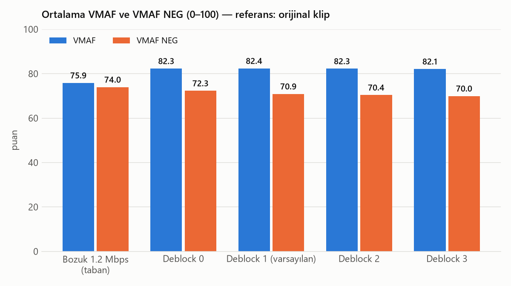
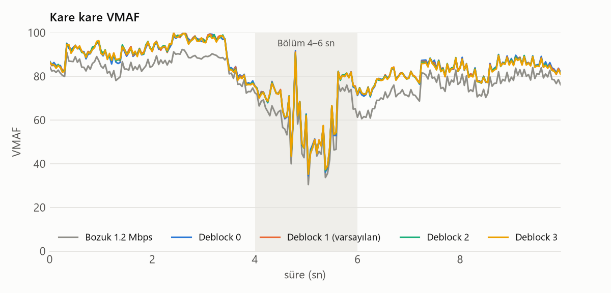

# Pixel Arttırıcı

**Windows + NVIDIA RTX için, düşük bit hızlı 1080p videoları önceden işleyerek 4K'ya çıkaran araç.**
Sıkıştırma bloklarını temizler ve görüntüyü netleştirir: filmde TensorRT ile DPIR + Real-ESRGAN, animede Video2X ile Real-ESRGAN anime.
Tonu sabit tutar, isteğe bağlı olarak RIFE ile kare hızını artırır ve bütün ses/altyazı izlerini dokunmadan taşır.

[English README](README.md)


*Tears of Steel, bilerek 1,2 Mbps'e bozuldu ve varsayılan film ayarlarıyla işlendi. Çizginin solu kaynak (lanczos ile 4K'ya büyütülmüş), sağı sonuç.
4K çıktıdan 640x267'lik bir bölge 1,5 kat büyütüldü; böylece fark README boyutunda görülebiliyor. Tam karede fark daha incedir.*


*Aynı klip, ¼ hızda hareket eden bir yüz, 4K pikselleri olduğu gibi (960x540'lık bölge): baş dönerken kaynaktaki bloklar kayıyor; sonuçta gözlük ve yüz kenarları daha temiz kalıyor.*

> **Dürüst beklenti.** Ortalamada sonuç belirgin şekilde daha temiz ve keskin görünür (VMAF +6,5).
> Ama görüntüyü orijinaline **yaklaştırmaz**: keskinleştirmeyi ödüllendirmeyen VMAF NEG ve PSNR yerinde sayar ya da biraz düşer.
> En ağır bloklanmış hızlı hareketli karelerde kaybolan ayrıntı geri gelmez, kazanç küçüktür.
> Bu rakamlar tek bir 10 saniyelik film klibinden alındı (bkz. [Ölçümler](#ölçümler)).

---

## Kimin için?
Düşük bit hızıyla kodlanmış bir 1080p (ya da SD) dosyan var ve hareketli sahnelerde bloklanıyor ya da bulaşıyor. Örnekler: yayın kayıtları, eski indirmeler, TV kayıtları.
Ondan TV'de izlemek için daha temiz bir 4K dosya istiyorsun; anlık bir filtre değil. İşleme yavaştır (bölüm başına saatler), sonuç yeni bir dosyadır.

## Gereksinimler
| | |
|---|---|
| İşletim sistemi | Windows 10/11, 64 bit |
| Ekran kartı | NVIDIA **RTX** (20 serisi ve sonrası, compute capability ≥ 7.5), sürücü **≥ 580** |
| Python | python.org'dan **3.14** (`py` başlatıcısı ve tkinter dahil; ikisi de varsayılan olarak kurulur) |
| Disk | Kurulum sırasında ~10 GB, sonrasında ~4,5 GB boş alan (artı 4K çıktılar için yer) |
| İnternet | Yalnız kurulum için (yaklaşık 3,6 GB indirme) |

Geliştirme ve ölçümler RTX 5070 Laptop GPU üzerinde yapıldı.

## Kurulum
1. Bu repoyu indir (yeşil **Code** düğmesi → *Download ZIP*) ve aç, ya da `git clone` ile al.
2. **`kurulum.bat`** dosyasına çift tıkla, ya da klasörde PowerShell'de:
   ```powershell
   .\kurulum.bat                 # araçlar ve modeller
   .\kurulum.bat -VideoCompare   # isteğe bağlı olarak yan yana izleyici de ("Kendin incele")
   ```

Kurulum betiği önce GPU, sürücü, Python ve disk alanını denetler.
- Sonra her şeyi resmi kaynaklarından bu klasördeki `tools\` ve `models\` altına indirir; sistem geneline bir şey kurulmaz.
- Her dosyanın sürümü, boyutu ve SHA-256'sı sabittir; uyuşmazlık olursa kurulum durur.
- Kurulmuş parçalar atlanır, yarıda kalan indirmeler kaldığı yerden sürer.
- Film modeli, Real-ESRGAN'ın resmi `.pth` sürümünden yerelde ONNX'e çevrilir; PyTorch gerekmez.
- Her yeni video boyutunun ilk çalıştırmasında TensorRT motorları bir kez derlenir (~1–4 dk).

> Bu belgedeki bütün komutlar **PowerShell** içindir. cmd.exe'de baştaki `.\` ve `&` gerekmez.

## Kullanım
### Tıklamalı arayüz
**`arayuz.bat`** dosyasına çift tıkla (ya da `.\arayuz.bat`). Videoyu seç, *Film* ya da *Anime*'yi işaretle, **Başlat**'a bas.
Tahmini süre, ilerleme ve kalan süre görünür. Çalışan komutun tamamı günlüğe yazılır; repo klasöründe açılmış PowerShell'e olduğu gibi yapıştırılabilir.


### Komut satırı
```powershell
# Film, varsayılan ayarlar → cikti\<ad>_film_general4x_dpir15_hevc.mkv
py -3.14 yerel\iyilestir.py "C:\Videolar\film.mkv" --tur film

# Anime, önce 10 saniyelik deneme (5:00–5:10)
py -3.14 yerel\iyilestir.py "C:\Videolar\bolum.mkv" --tur anime --baslangic 300 --bitis 310

# 4K + 72 fps, Japonca ses (iz 2) ve harici Türkçe altyazı varsayılan
py -3.14 yerel\iyilestir.py "C:\Videolar\bolum.mkv" --tur anime --hedef-fps 72 --ses 2 --varsayilan-ses 2 `
    --ek "C:\Videolar\bolum.tr.srt" --varsayilan-altyazi -1
```
`--ses` / `--altyazi` için iz indekslerini arayüz listeler, ya da şu komutla görebilirsin:
`.\tools\ffmpeg\bin\ffprobe.exe -v error -show_entries stream=index,codec_type:stream_tags=language,title -of compact "C:\Videolar\bolum.mkv"`.

### Tüm seçenekler (`yerel\iyilestir.py`)
| seçenek | açıklama |
|---|---|
| `--tur film\|anime` | **Zorunlu.** Varsayılan modeli belirler. |
| `--model esrgan\|general\|cugan\|anime4k` | `general` (film varsayılanı): DPIR blok temizleme + realesr-general-x4v3, TensorRT. `esrgan` (anime varsayılanı): Video2X ile Real-ESRGAN animevideov3. `cugan`: Real-CUGAN, daha güçlü blok temizler ama tonu kaydırabilir. `anime4k`: hızlı, zayıf. |
| `--deblock-guc 0-3` | `general`: DPIR gücü 0 / 15 / 30 / 50, **varsayılan 1**. Yüksek değer cildi ve dokuyu pürüzsüzleştirir. `cugan`: gürültü seviyesi (varsayılan 3). |
| `--olcek auto\|2\|3\|4` | Büyütme katı; `auto` ~2160 px yüksekliğe ulaşan en küçük katı seçer. |
| `--baslangic`, `--bitis` | Yalnız bu aralığı işle (saniye); klip önce kayıpsız kesilir. |
| `--codec hevc\|av1`, `--cq 19` | NVENC 10-bit; düşük CQ daha kaliteli ve daha büyük dosya demektir. |
| `--hedef-fps 72\|120\|144` | RIFE ile kare hızını kaynağın en yakın tam katına çıkarır. |
| `--fps-yontem hizli\|kalite` | `hizli` (varsayılan): gerçek kareler dokunulmadan kalır, yalnız ara kareler 1080p'de RIFE 4.26 TensorRT ile hesaplanır. `kalite`: Video2X RIFE tam 4K'da, ~10 kat yavaş. |
| `--rife-model` | `kalite` yönteminin RIFE modeli (varsayılan `rife-v4.26`). |
| `--kesme-serbest` | Sahne kesmesi işlemeyi kapatır (kesmelerde iki sahne erir). |
| `--sira upscale-once\|fps-once` | Upscale ile RIFE'nin sırası; `upscale-once` (varsayılan) hem daha kaliteli hem ~2 kat hızlı. |
| `--sadece-kalite`, `--sadece-fps` | Yalnız upscale / yalnız kare hızı. |
| `--ton-serbest` | Ton sabitlemeyi kapatır. |
| `--ham-sakla` | Ton sabitlemeden önceki ham model çıktısını saklar. |
| `--taramali iki-kat\|ayni\|kapali` | Taramalı SD kaynak: `iki-kat` (varsayılan) her alan bir kare olur (25i → 50p), `ayni` kare hızı aynı kalır, `kapali` dokunulmaz. |
| `--ses`, `--altyazi` | `hepsi` (varsayılan), `yok` ya da virgüllü akış indeksleri. |
| `--varsayilan-ses`, `--varsayilan-altyazi` | Varsayılan iz (kaynak indeksi; `-1`, `-2` … = birinci, ikinci harici dosya). |
| `--ek DOSYA` | Harici ses/altyazı dosyası, tekrarlanabilir; adında `.tr`/`.en`/`.jp` varsa dil etiketlenir. |
| `-o DOSYA` | Çıktı dosyası. |

Yarıda kalan bir iş aynı ayarlarla yeniden başlatılırsa biten aşamalar (ör. 4 saatlik upscale) atlanır. Her çalıştırma `cikti\iyilestir_log.csv`'ye bir satır ekler.

**SD / DVD dosyaları** (`.vob`, `.mpg`, `.mpeg`, `.m2v` ya da herhangi bir SD kaynak) önce kayıpsız bir hazırlık adımından geçer:
- Taramalı görüntü `idet` ile algılanıp `bwdif` ile giderilir.
- NTSC 3:2 pulldown geri alınır.
- Kare olmayan pikseller kare yapılır.
- BT.601 renk BT.709'a çevrilir.
- 4K'dan büyük çıktı 3840x2160'a sığdırılır.

Parçalı DVD başlıkları (`VTS_01_1.VOB`, `VTS_01_2.VOB` …) önceden tek dosyaya birleştirilmelidir.

## Ölçümler
- **Kaynak:** *Tears of Steel* 06:51–07:01 (10 sn, 1920x800, 24 fps), **bilerek 1,2 Mbps'e yeniden kodlandı** (x264 medium, tek geçişli ABR).
- **Referans:** orijinal klip.
- **Yöntem:** işlenmiş 4K çıktı lanczos ile referans boyutuna indirilip libvmaf ile karşılaştırıldı. Ölçülenler: VMAF, **VMAF NEG** (keskinleştirmeyi ve kontrast artışını ödüllendirmeyen türü), PSNR-Y ve SSIM.
- **Hizalama:** kareler sıra numarasıyla eşlendi (zaman damgaları yeniden üretildi); 240 karenin hepsi ölçüldü.
- **Araç:** `yerel\olc.py`. Yeniden üretmenin bütün adımları: [docs/uret.md](docs/uret.md).

| video | VMAF | VMAF NEG | VMAF en düşük | PSNR-Y (dB) | SSIM |
|---|--:|--:|--:|--:|--:|
| Bozuk 1,2 Mbps (taban) | **75,87** | **73,95** | 30,44 | 37,96 | 0,9732 |
| Deblock 0 | **82,33** | **72,32** | 34,51 | 35,92 | 0,9716 |
| Deblock 1 (varsayılan) | **82,39** | **70,91** | 35,25 | 35,20 | 0,9700 |
| Deblock 2 | **82,26** | **70,41** | 35,26 | 34,95 | 0,9693 |
| Deblock 3 | **82,13** | **69,96** | 35,19 | 34,74 | 0,9686 |

Yalnız hızlı hareketli bölüm (4–6 sn, 48 kare):

| video | VMAF | VMAF NEG | PSNR-Y (dB) | SSIM |
|---|--:|--:|--:|--:|
| Bozuk 1,2 Mbps (taban) | **58,80** | **57,22** | 33,74 | 0,9366 |
| Deblock 1 (varsayılan) | **64,32** | **56,40** | 31,65 | 0,9320 |




Nasıl okunur:
- **VMAF tüm klipte 6,5, hareketli bölümde 5,5 puan artıyor.** Gözle de bloklar kayboluyor, kenarlar keskinleşiyor.
- **VMAF NEG ve PSNR artmıyor.** Kazanç algılanan netlikten geliyor, orijinalin geri kurulmasından değil. Model inandırıcı ayrıntı üretiyor ve ince dokuyu (deri gözenekleri, gren) yumuşatıyor; aşağıdaki kırpımlara bak.
- **Ağır bloklanmış hızlı hareketli kareler** (5. saniye civarı) kaynak kadar kötü kalıyor; kaybolan bilgi geri gelmiyor.
- **Deblock gücü** bu klipte VMAF'ı neredeyse değiştirmiyor, ama yüksek güçler NEG ve PSNR'ı düşürüyor (daha çok yumuşatma). Varsayılan 1.
- **Kare hızı artırma gerçek kareleri bozmuyor.** `--hedef-fps 72` (hızlı yöntem) ile ölçülen gerçek kareler 82,05 VMAF / 70,31 NEG, 24 fps'te ise 82,26 / 70,41 (deblock 2). Küçük fark fazladan bir kodlama turundan.
- **Örneklemin sınırı:** tek bir 10 saniyelik film klibi; anime yalnız gözle değerlendirildi. Çıktı bit hızı (4K 10-bit için ~17 Mb/s) bir kalite ölçüsü değildir.

### Detay kırpımları (2 kat büyütme): kaynak | sonuç | orijinal
Yüz (t = 1 sn): göz, kirpik ve kenarlar daha keskin, deri üzerindeki bloklar gitmiş; ama orijinaldeki ince deri dokusu da yumuşamış.

Hızlı hareket (t = 5,2 sn), klibin en ağır bloklanmış yeri: bloklar yumuşamış, orijinalin ayrıntısı geri gelmemiş.

Ekran yazısı (t = 8 sn): kenarlar biraz daha temiz; fark küçük.


## Hız
Ölçüm ortamı: RTX 5070 Laptop GPU (sürücü 596.21), Intel Core i7-14650HX, prizde. TensorRT motorları önceden derlenmişti ve bütün diğer GPU işleri durdurulmuştu (`nvidia-smi` ile denetlendi).
Hız; arayüz önde, simge durumunda ya da başka bir uygulamanın arkasındayken aynıdır (10 saniyelik film klibi: 75,4 / 76,5 / 75,8 sn). Bkz. aşağıda *Arka planda yavaşlama yok*.

| iş | kaynak | model aşaması | işin tamamı¹ | 24 dk'lık bölüm (tahmin) |
|---|---|--:|--:|--:|
| Film, varsayılan (DPIR + realesr-general-x4v3) | 1920x800 | 3,9 kare/sn | 3,2 kare/sn | ~3,0 sa |
| Anime, varsayılan (Real-ESRGAN animevideov3, Video2X) | 1920x1080 | 4,0 kare/sn | 2,5 kare/sn | ~3,8 sa |
| + `--hedef-fps 72` (hızlı RIFE, 4K film çıktısında) | 3840x1600 | 52 çıktı karesi/sn | videonun her 10 sn'si için +14 sn | +~0,6 sa |

¹ Ton sabitleme (CPU) ve 10-bit HEVC kodlama dahil. 1920x1080 bir film kaynağı, 1920x800 klipten ~%35 fazla piksel içerir ve buna göre daha yavaş işlenir (ölçülmedi).
`--fps-yontem kalite` (4K'da Video2X RIFE) hızlı yöntemin yaklaşık 10 katı sürer. Hızlar *kaynak* karesi/sn'dir.

## Kendin incele
İsteğe bağlı izleyiciyi bir kez kur: `.\kurulum.bat -VideoCompare` ([video-compare](https://github.com/pixop/video-compare), GPL-2.0, `tools\video-compare` altına). Sonra:
```powershell
.\tools\video-compare\video-compare.exe -W "C:\Videolar\film.mkv" ".\cikti\film_film_general4x_dpir15_hevc.mkv"
```
- İki video kare kare eşzamanlı oynar. Dikey çizgiyi fareyle sürükle: sol kaynak, sağ sonuç.
- 1080p kaynak, 4K çıktının boyutuna kendiliğinden büyütülür.
- **Tuşlar:** `Space` oynat/duraklat · `A`/`D` önceki/sonraki kare · `Z` büyüteç · `0` fark görünümü · `Tab` sıradaki sağ video · `H` yardım · `Esc` çıkış.
- **Birden çok sonucu tek kaynakla karşılaştırmak için:** `.\tools\video-compare\video-compare.exe -W kaynak.mkv sonuc1.mkv sonuc2.mkv` (`Tab` ile geçiş).
- **İki dosya biraz farklı anda başlıyorsa** sağdakini kaydır: `-t 0.042` (saniye).

Bunun yerine karşılaştırma videosu ve kareleri üretmek için:
`py -3.14 yerel\karsilastir.py <kaynak> <sonuç> --mod kayar|bolunmus|ust-alt|yanyana [--kirp X:Y:G:Y]`.
Nesnel ölçüm için: `py -3.14 yerel\olc.py <orijinal> <sonuç...> --taban <kaynak>` (bkz. [docs/uret.md](docs/uret.md)).

## Tasarım kararları
- **Ton sabitleme.** Büyütme modelleri parlaklığı ve rengi sahneye göre farklı kaydırıyor; Real-CUGAN karanlık karelerde parlaklığı 4,5 birime kadar düşürüyordu. Bu, HDR açılıp kapanıyormuş gibi hissettiriyor.
  - Büyütmeden sonra her karenin kaba tonu kaynağa eşitleniyor: `çıktı = işlenmiş + bulanık(kaynak) − bulanık(işlenmiş)`. Fark 32x18'lik ızgarada hesaplanıp 9 kare boyunca ortalanıyor.
  - Daha sık ızgara ve zaman ortalaması olmadan, düzeltme altyazının ve hareket eden karakterlerin çevresinde titriyordu.
  - `--ton-serbest` ile kapatılır.
- **Kendi sahne kesmesi algılamamız** (`ortak\sahne.py`).
  - Video2X'in tek eşiği test kliplerinde iki yönden de başarısız oldu: ya karanlık bir kesmeyi kaçırdı (iki sahne eridi) ya da animenin bekletilen karelerini ve yavaş pan'ları kesme sayıp ara kare üretmeyi bıraktı. ffmpeg'in `scdet`'i de aynı sorunu yaşıyordu.
  - Kullanılan kural: renk histogramı farkı ≥ 0,35, ya da hareket dengelemeli fark, hareketli komşularının medyanından çok yüksek olmalı. Tekrarlanan (bekletilen) kareler hesaba katılmıyor.
  - Kesmede ara kare üretilmiyor, önceki kare bekletiliyor.
- **Hızlı ara kare.** Gerçek kareler dokunulmadan geçiyor; yalnız ara kareler 1080p'de RIFE 4.26 (TensorRT) ile hesaplanıp büyütülüyor. Tam 4K'da Video2X RIFE'den yaklaşık 10 kat hızlı. Ölçülen gerçek kareler neredeyse aynı (fazladan kodlamadan −0,2 VMAF).
- **BT.709 etiketi hatası.**
  - Sorun: ffmpeg 8, salt paketleme dönüşümünde (`yuv420p10le → p010le`) renk matrisini BT.601 olarak etiketliyordu, oysa değerler BT.709'du. Oynatıcı yanlış matrisle çözüyor, pembe/kırmızı sahneler koyulaşıyordu (yeşil kanal −7).
  - Çözüm: her kodlama artık açık BT.709 etiketi yazıyor ve süzgeç zincirleri `setparams` ile bitiyor. Gerekçe: çıkış bayrakları (`-color_trc`, `-color_primaries`) karenin özelliklerini ezmiyordu; kaynakta bu etiketler yoksa çıktıda `unknown` kalıyordu.
- **Ses ve altyazı.** Video tek başına üretiliyor; seçilen kaynak izleri ve harici dosyalar en sonda yeniden kodlanmadan ekleniyor. Böylece ses kare üretimini hiç etkilemiyor.
  - ASS yazı tipleri taşınıyor. Ekler en sonda eşleniyor, çünkü ffmpeg 8'de akış indeksi hatası var.
  - Kısmi işlemede ses FLAC'a çevriliyor, çünkü kopyalanan ses önceki anahtar kareden başlayıp kayıyor.
  - `-max_interleave_delta 0` kullanılıyor, çünkü ffmpeg aksi hâlde uzun bir 4K dosyada bütün sesi başa yazıyor ve oynatıcılar sarınca sesi kaybediyordu.
- **Arka planda yavaşlama yok.** Windows 11, penceresi simge durumundayken başka bir uygulama öndeyse o uygulamanın ve alt süreçlerinin hizmet kalitesini (QoS) düşürür: verimli çekirdeklere ve düşük frekansa iter.
  Düzeltmeden önce bu durumda 10 saniyelik klibin CPU'daki ton aşaması 14 yerine 84 sn sürdü (işin tamamı 76 yerine 147 sn); GPU aşamaları etkilenmedi.
  İş ve başlattığı her araç (ffmpeg, vspipe, Video2X) artık güç azaltmasından açıkça muaf tutuluyor (`SetProcessInformation` / `ProcessPowerThrottling`). Yönetici yetkisi gerekmiyor, süreç önceliği değiştirilmiyor.
- **Video2X'te doğru GPU.** Video2X'in Vulkan cihaz sırası Windows'un o anki GPU tercihine göre değişiyor; bir çalıştırmada `-d 0` sessizce dahili GPU'yu seçti (~20 kat yavaş). Ayrık NVIDIA GPU her çalıştırmada adından bulunuyor.
- **Ölçüm hizalaması.** Zaman damgaları yeniden üretilmeden yapılan karşılaştırma, bozuk klibe 75,9 yerine 59,2 VMAF verdi; B-frame zaman damgaları kare eşlemesini kaydırıyordu. `olc.py` bu yüzden:
  - kareleri sıra numarasıyla eşliyor,
  - ±3 karelik kaymayı deniyor,
  - ara kareli çıktıda yalnız gerçek kareleri ölçüyor.

## Bilinen sınırlamalar
- Yalnız Windows ve NVIDIA RTX (TensorRT, NVENC 10-bit).
- Bkz. [Ölçümler](#ölçümler): daha keskin ve temiz, ama orijinale daha yakın değil.
  - Ağır bloklanmış hızlı hareketli kareler kurtarılamıyor.
  - İnce doku yumuşuyor; gürültülü SD ev kayıtlarında sonuç plastik görünebilir.
- Nesnel olarak yalnız tek bir 10 saniyelik film klibi ölçüldü.
- `--fps-yontem kalite` (Video2X RIFE) videonun son 2 karesini kaybediyor (ör. 2 saniyelik testte 144 karenin 142'si). Dosyanın geri kalanı ve ses senkronu etkilenmiyor; varsayılan hızlı yöntemde bu sorun yok.
- Her yeni video boyutunun ya da modelin ilk çalıştırmasında TensorRT motorları derleniyor (~1–4 dk).
- Yüksek kare hızlı 4K çıktıyı (72/120 fps) 60 Hz panelli TV'ler çoğu zaman oynatmıyor.
- Parçalı DVD başlıkları önceden birleştirilmeli; yalnız tek dosya kabul ediliyor.
- Arayüz ve mesajlar Türkçe.

## Teşekkür ve lisanslar
Bu repodaki kod: [MIT](LICENSE).
Üçüncü taraf araçlar ve modeller repoya **dahil değildir**. `kurulum.ps1` onları resmi kaynaklarından indirir ve her biri kendi lisansını korur:

| bileşen | lisans | kaynak |
|---|---|---|
| Video2X 6.4.0 | AGPL-3.0 | [k4yt3x/video2x](https://github.com/k4yt3x/video2x) |
| Real-ESRGAN modelleri (animevideov3, plus, general-x4v3) | BSD-3-Clause | [xinntao/Real-ESRGAN](https://github.com/xinntao/Real-ESRGAN) |
| Real-CUGAN | MIT | [bilibili/ailab](https://github.com/bilibili/ailab) |
| RIFE 4.26 (Practical-RIFE) | MIT | [hzwer/Practical-RIFE](https://github.com/hzwer/Practical-RIFE) |
| DPIR | MIT | [cszn/DPIR](https://github.com/cszn/DPIR) |
| Anime4K | MIT | [bloc97/Anime4K](https://github.com/bloc97/Anime4K) |
| ncnn, libplacebo | BSD-3-Clause, LGPL-2.1 | [Tencent/ncnn](https://github.com/Tencent/ncnn), [libplacebo](https://code.videolan.org/videolan/libplacebo) |
| VapourSynth R79 | LGPL-2.1 | [vapoursynth/vapoursynth](https://github.com/vapoursynth/vapoursynth) |
| vs-mlrt v15.16 | GPL-3.0 | [AmusementClub/vs-mlrt](https://github.com/AmusementClub/vs-mlrt) |
| NVIDIA TensorRT 10.16, CUDA 13.2 çalışma zamanı | NVIDIA lisansı | vs-mlrt sürümüyle birlikte gelir |
| BestSource | MIT | [vapoursynth/bestsource](https://github.com/vapoursynth/bestsource) |
| FFmpeg 8.1.1 (gyan.dev essentials derlemesi, libvmaf'lı) | GPL-3.0 | [GyanD/codexffmpeg](https://github.com/GyanD/codexffmpeg) |
| libvmaf | BSD-2-Clause-Patent | [Netflix/vmaf](https://github.com/Netflix/vmaf) |
| 7-Zip (7zr.exe) | LGPL-2.1 | [ip7z/7zip](https://github.com/ip7z/7zip) |
| video-compare (isteğe bağlı) | GPL-2.0 | [pixop/video-compare](https://github.com/pixop/video-compare) |
| Python, numpy, onnx | PSF, BSD-3-Clause, Apache-2.0 | python.org, PyPI |

Demo görüntüsü: **Tears of Steel — (CC) Blender Foundation | mango.blender.org** (film: CC-BY 3.0). Film müziği CC-BY-ND 3.0'dır; bu repoda hiç ses yoktur.

Kodumuz Video2X'i ve FFmpeg'i ayrı programlar olarak çağırır. İki VapourSynth betiği (`yerel\film_hat.vpy`, `yerel\rife_hat.vpy`) çalışma anında vs-mlrt'yi (GPL-3.0) içe aktarır. vs-mlrt burada dağıtılmaz; MIT de GPL ile uyumludur.

[Claude Code](https://claude.com/claude-code) ile geliştirildi.
